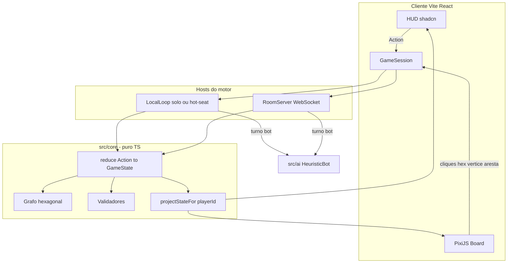
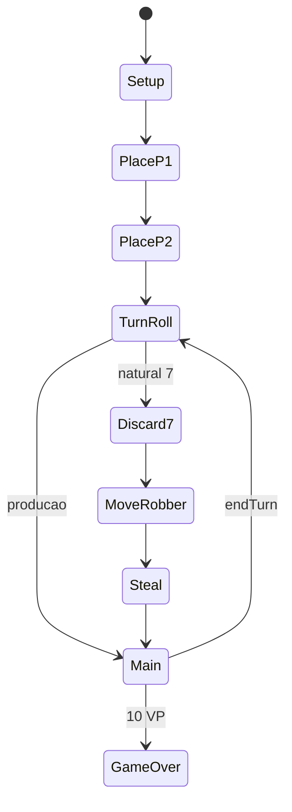

---
todos:
  - id: rfc-scaffold
    status: completed
    content: Versionar RFC em docs/ARCHITECTURE.md e scaffold Vite+React+Tailwind+shadcn+Pixi+Vitest
  - id: core-engine
    status: completed
    content: 'TDD RED-GREEN no grafo hexagonal, reduce de Action, filtros de view e regras base (Vitest)'
  - id: turn-loop
    status: completed
    content: 'TDD da maquina de turnos, setup oficial, producao, 7/ladrao, builds, cartas, score — integracao'
  - id: slice-review
    content: 'Apos cada fatia (core, turnos, HUD, IA, multiplayer): review de conformidade com o RFC + qualidade, corrigir criticos antes de seguir'
    status: pending
  - id: pixi-hud
    status: completed
    content: 'Renderer pixel art PixiJS + HUD React (dados, mao, comercio, feedbacks) jogavel no browser'
  - id: ai-solo
    status: completed
    content: HeuristicBot e modo Solo (1 humano + bots)
  - id: multiplayer
    status: completed
    content: 'Servidor ws autoritativo, salas, reconnect e views por jogador'
  - id: qa-deploy
    status: completed
    content: 'Vitest verde, Docker/Render, README, Preview no dev server'
name: Catan Pixel Architecture
overview: 'RFC de arquitetura para um MVP completo de Catan em pixel art: motor de regras TypeScript determinístico, tabuleiro hexagonal (PixiJS), HUD React, bots heurísticos e multiplayer autoritativo por salas WebSocket. Desenvolvimento segue a metodologia Superpowers (TDD, planos em fatias, review em duas etapas) adaptada ao Cloud Agent — o plugin obra/superpowers nao esta instalado nesta sessao.'
isProject: false
---
# RFC: Colonos — Catan Pixel Art (MVP)

Fan game educacional inspirado nas regras base de Catan (Catan GmbH). Nome do produto: **Colonos**. UI em **pt-BR**. Escopo: regras base 3–4 jogadores (solo preenche com bots). Fora: Cidades e Cavaleiros, 5–6 jogadores, marítimos extras.

Este RFC registra decisões autônomas (melhor prática da indústria). Após aprovação, a implementação segue o pipeline das Fases 2–4 no mesmo repositório.

---

## 1. Stack tecnológico

### Decisão

- **Linguagem**: TypeScript estrito em todo o repo (core, IA, servidor, cliente).
- **App**: **Vite 6 + React 19** (SPA), não Next.js.
- **Tabuleiro**: **PixiJS v8** + **@pixi/react** (WebGL, pixel-perfect `SCALE_MODES.NEAREST`).
- **HUD / lobby / diálogos**: React + Tailwind + **shadcn/ui**.
- **Testes**: Vitest (unitário + integração do loop de turnos).
- **Multiplayer**: servidor **autoritativo** Node (`ws`) + código de sala de 6 caracteres. Sem P2P, sem Colyseus, sem PartyKit.
- **Deploy**: Docker (Nginx/estático + Node no mesmo compose) pronto para Render. Solo e hot-seat funcionam 100% no browser, sem servidor.

### Justificativas

- **Vite vs Next.js**: PixiJS exige `window`/WebGL. Next.js força `dynamic(..., { ssr: false })` e complica WebSocket persistente (Vercel não segura WS long-lived). Catan não precisa de SEO/SSR.
- **PixiJS vs Phaser**: o jogo é tabuleiro + HUD densa (trocas, cartas, scores). Phaser compete com React pelo input/UI. PixiJS renderiza o hex map; React cuida de lobby, mão, comércio e toasts. `@pixi/react` v8 é a integração oficial (React 19).
- **Servidor próprio vs P2P/Colyseus/PartyKit**: Catan tem informação oculta (mão de recursos, cartas de desenvolvimento, baralho). P2P vaza estado e quebra em NAT. Colyseus/PartyKit exigem conta/infra extra. Um `ws` fino reutiliza o mesmo `src/core` do solo — um só motor de regras, dois hosts (local e sala).
- **Sem auth/DB**: salas em memória, TTL ~2h. Zero chaves de API.

### Pixel art

Paleta fixa 16 cores (terra, floresta, pasto, colina, montanha, deserto, mar, UI). Hexes, estradas, aldeias e cidades desenhados em **Graphics/sprites procedurais** no Pixi (controle total, sem dependência de atlas externo). Ícones de recursos, dados, ladrão e cartas: sprites 32×32 / 48×48 gerados com `GenerateImage` (estilo pixel, sem anti-alias) e importados como texturas `NEAREST`. Escala inteira (2×/3×) para evitar blur.

---

## 2. Arquitetura do sistema



**Princípio**: `GameState` é um snapshot imutável. Toda jogada é uma `Action` discriminada. `reduce(state, action) -> Result<GameState, RuleError>`. O servidor e o solo usam a mesma função. Clientes nunca aplicam regras sozinhos no modo online — só enviam a intenção e recebem `PublicView` filtrada.

Máquina de estados:



---

## 3. Modelagem matemática do tabuleiro

Referência: [Red Blob Games — Hexagonal Grids](https://www.redblobgames.com/grids/hexagons/). Hexes **pointy-top** (visual clássico de Catan).

### Hexes (faces)

Armazenar **axial** `(q, r)`; calcular **cube** `s = -q - r` só para distância/vizinhos.

- Terra: todos os hexes com distância cube `≤ 2` da origem → **19 hexes**.
- Mar/portos: anel `distance === 3` → 18 slots; **9 portos** nos lados (alternando costa / porto).
- Terrenos (base): 4 pasto, 4 floresta, 4 campo, 3 colina, 3 montanha, 1 deserto.
- Tokens: `2,3,3,4,4,5,5,6,6,8,8,9,9,10,10,11,11,12` no deserto = sem token + ladrão inicial.
- Dois setups: **tabuleiro iniciante** (fixo, oficial) e **aleatório** (hexes embaralhados; números em espiral a partir de uma ponta, pulando o deserto — setup variável oficial).

Pixel → mundo:

```
x = size * sqrt(3) * (q + r/2)
y = size * 1.5 * r
```

`size` em pixels inteiros (ex.: 32) para alinhamento pixel-perfect.

### Vértices (aldeias/cidades) — 54

Um vértice é o encontro de até 3 hexes. ID canônico: ordenar as 3 coordenadas cube dos hexes adjacentes (hexes de mar preenchem bordas com 2 hexes de terra + 1 mar).

```
VertexId = join(sorted(neighborHexIds))
Vertex { id, hexes[2|3], edges[2|3], building?: { type: settlement|city, owner } }
```

Regra da distância: nenhum vértice adjacente (compartilha aresta) pode ter construção.

### Arestas (estradas) — 72

```
EdgeId = join(sorted([vertexA, vertexB]))
Edge { id, vertices: [a, b], road?: owner }
```

Estrada legal: conectada à rede do jogador (estrada ou construção própria adjacente) e aresta livre.

### Índices auxiliares (O(1))

- `hexByCoord`, `verticesOfHex[6]`, `edgesOfHex[6]`
- `neighbors(vertex)`, `hexesProducing(vertex)` para distribuição no dado
- Grafo de estradas por jogador para **Maior Estrada** (caminho simples mais longo ≥ 5)

### Economia e peças (estoque oficial)

- Recursos: `wood | brick | sheep | wheat | ore`
- Por jogador: 15 estradas, 5 aldeias, 4 cidades
- Custos: estrada 1+1, aldeia 1+1+1+1, cidade 2 wheat + 3 ore, carta 1+1+1
- Baralho de desenvolvimento (25): 14 cavaleiros, 5 VP, 2 estradas, 2 monopólio, 2 ano da fartura
- 7 no dado: quem tem **>7 cartas** descarta metade (arredonda para baixo); move ladrão; rouba 1 carta de um dono adjacente
- Portos: 4× 3:1 genéricos + 5× 2:1 (um por recurso)
- Pontos: aldeia 1, cidade 2, maior estrada 2, maior exército 2 (3+ cavaleiros), VP ocultos. Vitória **10 VP** no próprio turno (incluindo revelar VP).

Colocação inicial: 2 aldeias + 2 estradas; 2ª ronda em ordem inversa; recursos iniciais = hexes da 2ª aldeia.

---

## 4. Módulos de implementação

Layout (pacote único, sem monorepo):

- [`docs/ARCHITECTURE.md`](docs/ARCHITECTURE.md) — este RFC versionado no repo
- [`src/core/`](src/core/) — board, actions, reduce, view filters, scoring
- [`src/ai/`](src/ai/) — `HeuristicBot.choose(state, playerId): Action`
- [`src/server/`](src/server/) — rooms, broadcast de views, bots no turno
- [`src/client/`](src/client/) — rotas lobby/jogo, Pixi board, HUD
- [`tests/`](tests/) — Vitest espelhando regras e um jogo completo solo vs bots até vitória ou N turnos

Contrato de ações (exemplo):

```ts
type Action =
  | { type: "PLACE_SETTLEMENT"; vertexId: string }
  | { type: "PLACE_ROAD"; edgeId: string }
  | { type: "ROLL" }
  | { type: "DISCARD"; resources: ResourceMap }
  | { type: "MOVE_ROBBER"; hexId: string; stealFrom?: PlayerId }
  | { type: "TRADE_BANK"; give: Resource; take: Resource; count: 2 | 3 | 4 }
  | { type: "OFFER_TRADE"; ... } | { type: "ACCEPT_TRADE"; offerId: string }
  | { type: "BUILD_SETTLEMENT" | "BUILD_CITY" | "BUILD_ROAD"; ... }
  | { type: "BUY_DEV" }
  | { type: "PLAY_KNIGHT" | "PLAY_ROAD_BUILDING" | "PLAY_YEAR" | "PLAY_MONOPOLY"; ... }
  | { type: "END_TURN" }
```

Uma carta de desenvolvimento **não** pode ser jogada no turno em que foi comprada (exceto VP ao reivindicar vitória). Cavaleiro pode ser jogado **antes** da rolagem.

### IA (heurística, não RL)

1. **Placement**: maximizar Σ(pips dos hexes) × diversidade de terreno × bônus de porto 2:1 se já houver concentração daquele recurso.
2. **Build**: prioridade cidade > aldeia em hexes de 6/8 > estrada que destrava aldeia > carta se faltar cavaleiro/VP.
3. **Robber**: bloquear o líder (VP, desempate produção) no hex de maior pip que ele toca e não é o deserto.
4. **Trade**: aceitar se o saldo de “recursos em falta para o próximo build” melhorar e não entregar 6/8 exclusivos ao líder.
5. **Tempo**: bot age com delay 400–800 ms para leitura humana.

### Multiplayer

- Lobby: criar/entrar sala, 3–4 slots, bots opcionais para preencher, host inicia.
- Host local = o Node da máquina; na web, o mesmo binário no Docker.
- Cada cliente recebe `PublicView`: tabuleiro completo + **própria** mão + contagens dos outros + cartas de desenvolvimento **não reveladas** só como quantidade.
- Reconnect: `playerToken` no localStorage reatacha à sala.
- Sem chat obrigatório; log de ações no HUD basta.

### UI / UX

- Desktop: tabuleiro central + painel direito (mão, builds, comércio).
- Mobile: tabuleiro pinch-zoom (`pixi-viewport` ou pan manual) + bottom sheet para ações do turno.
- Estados: vazio (lobby sem sala), loading (conexão), erro (sala cheia / ação ilegal com toast da `RuleError`).
- Animações: dados 2d pixel (spritesheet curto), flash nos hexes que produzem, ladrão andando 1 hex por tween.

---

## 5. Superpowers — cabe, com adaptacao

Referencia: [obra/superpowers](https://github.com/obra/superpowers) (Jesse Vincent / Prime Radiant). E uma biblioteca de skills de processo (brainstorming, TDD, worktrees, subagentes, review), nao um runtime de jogo.

**Veredito:** sim, e o encaixe certo para este projeto — motor de regras grande, facilmente quebravel, e exatamente o caso em que TDD + fatias pequenas + review em duas etapas evitam um tabuleiro “quase certo”. **Nao vamos instalar o plugin nesta sessao Cloud:** ele nao esta no catalogo de skills do agente (`~/.cursor/skills*`), `/add-plugin` nao e acao disponivel aqui, e o usuario nao precisa autenticar nada. Em vez disso, o RFC **adota a metodologia** como contrato de execucao.

### Adotar (alto valor no Catan)

- **writing-plans / executing-plans:** cada fatia da secao 7 vira um passo verificavel (arquivos, teste, commit). Ja temos o RFC; o plano de implementacao e o artefato `writing-plans`.
- **test-driven-development (RED-GREEN-REFACTOR):** obrigatorio em `src/core` e `src/ai` (grafo, reduce, 7/ladrao, cartas, pontuacao, heuristica). Fluxo: teste que falha → minimo para passar → refactor → commit. Codigo de regras sem teste vermelho primeiro nao entra.
- **subagent-driven-development (adaptado):** fatias independentes (ex.: grafo vs. HUD vs. servidor) podem ir para subagentes `generalPurpose`; depois review em duas etapas — (1) conformidade com este RFC, (2) qualidade/YAGNI. Criticos bloqueiam a fatia seguinte.
- **systematic-debugging:** quando um teste de regra ou o canvas falhar, causa raiz em 4 fases (reproduzir, isolar, hipotese, verificar), nao chute + patch.
- **verification-before-completion:** Vitest verde + Preview jogavel antes de declarar fatia pronta. UI: `computerUse` no browser, nao so screenshot.
- **YAGNI / DRY:** sem 5–6 jogadores, sem Cidades e Cavaleiros, sem Colyseus “por se”.

### Adaptar / nao seguir ao pe da letra (conflito com este ambiente)

- **brainstorming Socratico (1 pergunta por vez):** Fase 1 ja fechou as decisoes (stack, grafo, WS). Nao reabrir design no meio da implementacao, salvo bloqueio real.
- **using-git-worktrees + finishing-a-development-branch:** Cloud Agent exige **reusar o branch atual**, commit/push continuo, e **nao criar PR**. Worktrees paralelos tambem quebram o Preview unico e o `node_modules` compartilhado. Um branch, commits por fatia.
- **Checkpoints humanos a cada 2–5 min:** o usuario pediu execucao autonoma. Checkpoints so quando faltar credencial (neste projeto: nunca) ou decisao de produto nova.
- **TDD absoluto no Pixi/HUD:** testes primeiro no motor; no renderer, contrato de hit-test + QA visual (`computerUse`). Nao forcar snapshot de canvas como substituto de regra.
- **dispatching-parallel-agents no mesmo `src/core`:** nao paralelizar dois agentes no mesmo grafo/reduce (corrida de merge). Paralelo so entre eixos desacoplados (ex.: sprites/`GenerateImage` enquanto o core TDD roda).

### Como isso muda a execucao (apos aprovacao)

1. Gravar o RFC em `docs/ARCHITECTURE.md` (design doc Superpowers).
2. Core e turnos em ciclo RED-GREEN, um invariante por commit (19 hexes, 54 vertices, producao no token, descarte no 7, etc.).
3. Apos core, turnos, HUD, IA e multiplayer: review RFC + qualidade; so entao a proxima fatia.
4. Preview cedo (lobby + tabuleiro) em paralelo ao TDD do motor, sem adiantar regras sem teste.

---

## 6. Catalogo find-skills (descoberta desta sessao)

A skill `using-skills` / script `find-skills` do Superpowers **nao esta no disco** (`~/.config/superpowers/skills/` ausente). A descoberta foi o equivalente operacional: varrer todos os `SKILL.md` instalados em `~/.cursor/` (18 arquivos) e o catalogo remoto [obra/superpowers](https://github.com/obra/superpowers) + [obra/superpowers-skills](https://github.com/obra/superpowers-skills), filtrando por Catan / pixel art / TDD / multiplayer / QA.

### Usar de verdade (instaladas neste Cloud Agent)

- **walkthrough-artifacts** — ao terminar: video/screenshot do lobby, colocacao inicial, rolagem de dados e um turno completo. Nao e opcional no handoff.
- **env-setup** — so se `npm`/Vite/porta falharem no boot. Nao criar environment.json “por precaução”.
- **subscribe** — opcional depois do primeiro push, para CI Origin/GitHub sem polling. Nao bloqueia o MVP.

### Seguir como metodologia (Superpowers, plugin nao instalado)

Lidas nesta iteracao (frontmatter `when_to_use`):

- **using-skills / find-skills** — checar skills antes de cada fatia grande.
- **writing-plans** — plano em `docs/superpowers/plans/` com tarefas RED-GREEN e caminhos de arquivo; o RFC em `docs/ARCHITECTURE.md` e o spec.
- **executing-plans** / **subagent-driven-development** — executar fatia a fatia; review em duas etapas. Subagentes ok; **inline** no mesmo branch (sem worktree).
- **test-driven-development** — motor e IA.
- **testing-anti-patterns** — testes do `reduce` no estado real, sem mockar o grafo; bots testados por “Action sempre legal”, nao por mock de RNG a esmo.
- **systematic-debugging** + **verification-before-completion** — falha de regra ou canvas: causa raiz, depois Vitest fresco antes de clamar verde.
- **requesting-code-review** — apos cada modulo (core, turnos, HUD, IA, net), subagente revisor contra o RFC.
- **dispatching-parallel-agents** — so eixos desacoplados (sprites vs. TDD do core). Nunca dois agentes no mesmo `src/core`.

### Principios de design a adotar sem plugin

- **anthropics/frontend-design** (nao instalada): HUD/lobby com paleta pixel deliberada, tipografia nao-generica, zero “AI slop” (gradiente roxo, Inter, cards de SaaS). Combina com shadcn usado como primitivo, nao como visual final.
- **cursor.GenerateImage** — sprites 32×32/48×48 (recursos, dados, ladrao, cartas). Nao e skill de arquivo, e ferramenta nativa.

### Nao usar neste projeto

- **using-git-worktrees**, **finishing-a-development-branch** — Cloud Agent reusa o branch atual e nao abre PR.
- **brainstorming** — Fase 1 ja fechou; so reabre se o RFC quebrar.
- **writing-skills** — nao criar uma skill “catan-rules”; o core testado e a fonte da verdade.
- **migrate-to-builds** — fora do pedido.
- **Toda a familia Figma** (`figma-use`, `figma-generate-design`, `figma-generate-library`, `figma-implement-motion`, `figma-generate-diagram`, `generate-project-plan`, `video-interaction-mapper`, SwiftUI/Slides/FigJam) — MCP Figma esta `needsAuth`. Pixel art + diagramas Mermaid no RFC cobrem o mesmo papel sem autenticar. Se o usuario autenticar Figma depois, `figma-generate-diagram` (maquina de turnos) e `figma-generate-design` (HUD) viram opcionais — nao bloqueiam o MVP.
- **anthropics/canvas-design** e **algorithmic-art** — arte estatica/p5.js, nao tabuleiro jogavel.
- **bugbot** / **security-review** — so se o usuario pedir explicitamente.

### Mapa ferramenta × fatia

- Codigo: Read / Write / StrReplace
- Scaffold, Vitest, Docker: Shell
- Regras oficiais / edge cases: WebSearch / WebFetch
- Sprites: `cursor.GenerateImage`
- QA canvas + HUD: subagente `computerUse`
- Review de fatia: subagente `generalPurpose` no papel Superpowers code-review
- Demo: `walkthrough-artifacts`
- Processo: Superpowers (TDD, anti-patterns de teste, verification-before-completion)

Fluxo de testes (Fase 3), executado no terminal ate ficar verde (evidence before claims):

- Unit: geracao do grafo (19/54/72), distancia, producao, custos, 7, portos, maior estrada/exercito, baralho, carta no mesmo turno.
- Integracao: setup + 2 placements + N turnos com 4 bots sem `RuleError` interno; vitoria em 10 VP detectada.
- Contrato de view: jogador B nao ve a mao de A.
- Sem mock do motor: o `reduce` corre no `GameState` real.

---

## 7. Deploy e handoff (Fase 4)

Arquivos: `Dockerfile`, `docker-compose.yml` (client build + `node src/server`), `render.yaml`. README com `npm run dev` (Vite `:43123` + proxy WS) e `docker compose up`.

**Nenhuma credencial é necessária** para solo, hot-seat ou multiplayer na LAN. A única ação manual do usuário: publicar o Docker num host com porta TCP pública (Render/Fly) se quiser salas pela internet. Não interromper o agente por API keys.

---

## 8. Ordem de entrega (após aprovação deste RFC)

Implementação incremental **no branch atual**, commit/push a cada fatia estável. Ciclo Superpowers adaptado: TDD no motor → review de fatia → só então a próxima.

1. Scaffold Vite/React/Tailwind/shadcn + `docs/ARCHITECTURE.md` + README
2. `src/core` em RED-GREEN (grafo + reduce + views) — review RFC
3. Loop de turnos em RED-GREEN (setup, produção, 7, builds, cartas, score) — review RFC
4. Pixi board jogável (placement + roll + build) + HUD; QA `computerUse`
5. Cartas, ladrão, comércio banco/jogadores, pontuação, vitória (TDD no core, visual no HUD)
6. HeuristicBot + modo Solo — testes de “bot sempre emite Action legal”
7. RoomServer + lobby multiplayer — teste de filtro de view
8. Docker/Render + README de deploy; Preview card no dev server

Primeiro slice visível no browser: lobby + tabuleiro pixel com colocação inicial, para haver Preview cedo; o core continua em TDD em paralelo **sem dois agentes editando o mesmo `src/core`**.
