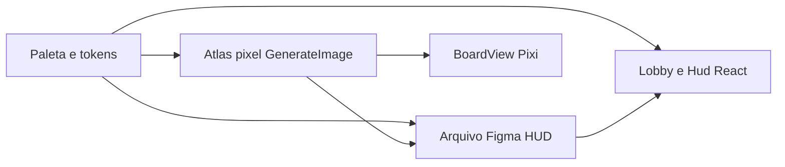

---
todos:
  - id: figma-foundations
    status: completed
    content: 'Criar arquivo Figma Colonos, tokens 16 cores, type Pixelify, componentes HUD v1'
  - id: pixel-atlas
    status: completed
    content: 'Gerar sprites pixel (terrenos, pecas, dados, cartas, logo) e atlas em public/sprites'
  - id: figma-screens
    status: completed
    content: Montar telas Lobby e Mesa (desktop + mobile) no Figma a partir dos componentes
  - id: react-hud-lobby
    status: completed
    content: 'Restilar Lobby, Hud e shadcn com tokens/painéis de madeira alinhados ao Figma'
  - id: pixi-table
    status: completed
    content: 'BoardView com atlas, pan/zoom inteiro, peca fantasma, pulso legal, dados/ladrao/producao'
  - id: qa-preview
    status: completed
    content: 'QA browser desktop+mobile, sons mute, Preview no dev server'
name: Colonos Visual Identity
overview: 'Identidade visual completa da Ilha das Lanternas: arquivo Figma (tokens + HUD), atlas pixel art gerado, e mesa Pixi interativa (pan/zoom, preview fantasma, dados, ladrão). O motor de regras em src/core permanece intacto.'
isProject: false
---
# Identidade visual Colonos — Ilha das Lanternas

Direção: releitura 1995 do Catan em pixel art aconchegante (madeira, ouro velho, lanternas), não cartoon neon e não “AI slop” roxo. UI em pt-BR. Figma já autenticado no time `lucas.balduino's team` (`team::1358419088772286907`). Sem novas credenciais.

O tabuleiro **não** é desenhado no Figma como hexes jogáveis: o Figma é source of truth do **HUD/lobby/tokens**; o atlas pixel é source of truth da **mesa**. Os dois compartilham a mesma paleta de 16 cores.

---

## Paleta travada (16 cores)

Definir em [`src/index.css`](src/index.css) e espelhar como variáveis Figma (primitivas + semânticas):

- Noite `#1a1520`, madeira `#3d2a1f`, painel `#2a2133`
- Pergaminho `#f4e8c8`, ouro `#d4a017`, ouro-escuro `#8a6410`
- Floresta `#2f6b32`, pasto `#6db35c`, trigo `#e0b33a`
- Tijolo `#b24a32`, pedra `#5c6573`, deserto `#c2a366`
- Mar `#16344a`, espuma `#9ad1e5`
- Facções: vermelho `#c44536`, azul `#2b6cb0`, laranja `#d97706`, marfim `#e8e0d0`

Tipografia: **Pixelify Sans** (já no projeto). Escala de sprite: base **32px**, hex **48px** pointy-top, `SCALE_MODES.NEAREST`, zoom só em inteiros (2x/3x).

Quatro facções visuais (não só tint): telhado vermelho, porto azul, argila laranja, lã marfim — aldeia/cidade/estrada com silhouette distinta.

---

## Arquivo Figma

Criar `Colonos — Ilha das Lanternas` via `create_new_file` (skill `figma-create-new-file` + `whoami` já resolvido). Skills na execução: `figma-use`, `figma-generate-library`, `figma-generate-design`.

Páginas v1 (escopo fechado, não um DS de 80 componentes):

- **00 Foundations** — paleta, type styles, logo wordmark, 4 swatches de facção
- **01 Components** — `PixelButton` (default/hover/pressed/disabled), `WoodPanel`, `ResourceChip`, `PlayerPlaque` (turno / idle / vencedor), `DicePair`, `PhaseBanner`, `DevCard`
- **02 Screens** — Lobby desktop + compacto; Mesa desktop (board + painel direito); Mesa mobile (board + bottom sheet); modal Descarte; faixa Vitória
- **03 Atlas** — sprites importados (`upload_assets`) só como referência, não como UI runtime

Não publicar library de time nem Code Connect nesta fatia (student plan; o ganho é baixo vs. o custo).

---

## Atlas pixel (GenerateImage)

Gerar em `public/sprites/` com prompt fixo: pixel art 32/48px, paleta acima, sem anti-alias, sem texto embutido (exceto pips dos dados). Recortar/atlas em [`src/client/assets.ts`](src/client/assets.ts).

Lista v1:

- 6 terrenos hex + deserto + anel de mar/porto
- Ladrão (2 frames idle)
- Aldeia + cidade × 4 facções
- Segmento de estrada × 4
- Dados 1–6
- 5 cartas de recurso + 5 costas/tipos de desenvolvimento
- Ícone de porto 3:1 e 2:1
- Wordmark COLONOS

Se um sprite sair “suave” ou fora da paleta, regenerar ou dither em canvas antes de atlas.

---

## Mesa Pixi — jogabilidade

Reescrever [`src/client/BoardView.tsx`](src/client/BoardView.tsx) (hoje Graphics tintidos, origem fixa `x=420 y=300`, sem zoom):

- Pan (arrastar) + zoom em roda/pinch com escala inteira; recentrar no island bounds
- Hover: hex/vértice/aresta com outline pixel e **peça fantasma** da ação legal
- Spots legais pulsam (aldeia/estrada/ladrão)
- Clique confirma; inválido = shake curto + toast já existente
- Dados: 8–12 frames de rolagem no HUD, depois faces finais
- Produção: flash no hex do token
- Ladrão: tween de 1 hex por vez até o destino
- Peças novas: pop 2–3 frames (scale 0.7 → 1.0 nearest)

Áudio mínimo sintetizado (Web Audio, sem arquivo): clique de peça, dados, vitória. Mute no lobby. Sem CDN de som.

---

## HUD e lobby no React

Restilar shadcn, não trocar de lib. Arquivos: [`src/client/Lobby.tsx`](src/client/Lobby.tsx), [`src/client/Hud.tsx`](src/client/Hud.tsx), [`src/index.css`](src/index.css), [`src/components/ui/button.tsx`](src/components/ui/button.tsx).

- Lobby: poster da ilha, wordmark, painéis de madeira, CTAs de madeira/ouro (solo / hot-seat / sala)
- HUD desktop: `WoodPanel` à direita — placa de jogadores, mão como cartas pixel, dados, fase, log em pergaminho
- Mobile: bottom sheet para ações; tabuleiro em tela cheia
- Comércio banco e descarte: chips de recurso clicáveis (já existe a lógica; falta a pele)
- Estados vazios/loading/erro do lobby de sala com a mesma moldura

[`src/core`](src/core) **não muda**.

---

## Ordem de execução

1. Tokens CSS + arquivo Figma Foundations/Components (library skill, fases 1–2 só no v1 acima)
2. GenerateImage → atlas + página 03 no Figma
3. Telas Lobby e Mesa no Figma (`figma-generate-design`)
4. Implementar lobby/HUD no React alinhado às telas
5. BoardView com atlas + pan/zoom + fantasma + tweens
6. QA `computerUse` desktop e viewport estreita; Preview no `:43123`

Verificação: um único render não basta — lobby → solo → placement com fantasma → bots → hover/zoom. Corrigir se o Figma e o app divergirem na paleta ou na hierarquia do HUD.
